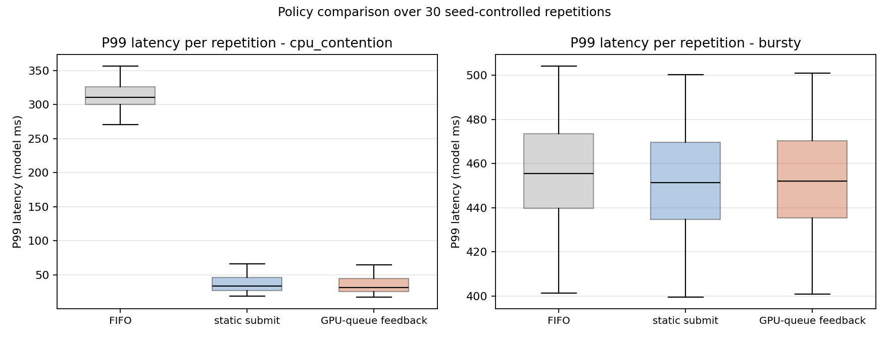
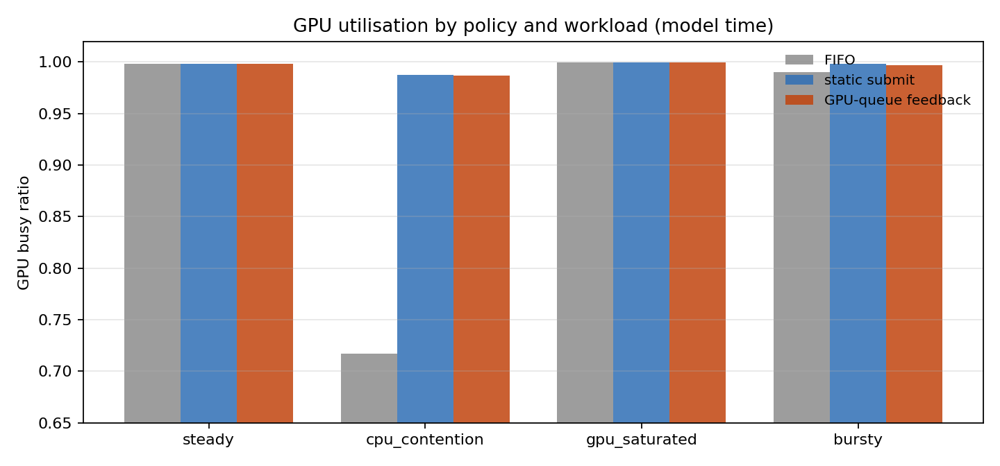
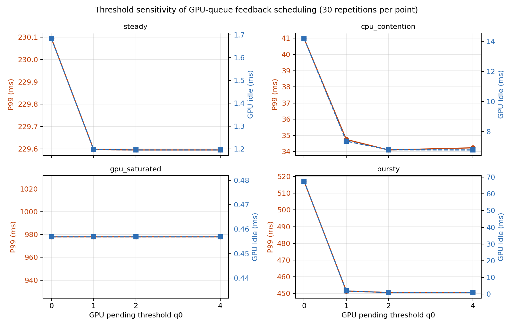

# CPU-GPU Pipeline Scheduling Simulator

[](https://github.com/Caden-1224/cpu-gpu-pipeline-scheduling/actions/workflows/ci.yml)
[](pyproject.toml)
[](LICENSE)

This is the code repository for the paper **Low-Latency Adaptive Scheduling for CPU-GPU
Pipelines Using GPU Queue Feedback** (Liu and Wen). It holds a seed-controlled
discrete-event model of CPU-side task selection in a pipelined inference service, where
every request passes through CPU preprocessing, submission, service on a single GPU,
and CPU postprocessing. Three dispatch policies are compared across four synthetic
workloads, with the frozen configuration, the per-repetition metrics and the figure
scripts published alongside the results.

Everything here is numerical. No GPU, CUDA runtime, driver or Linux *sched_ext* / eBPF
program is measured, and the results describe this model and its documented parameters.
Reproduction needs nothing beyond the Python standard library.

## Headline result

Under CPU contention, that is two non-preemptive cores shared by the request stages and
by background work, a single feedback bit (the pending GPU depth) lowers tail latency
while throughput stays essentially unchanged:

| workload | policy | throughput (req/ms) | P95 (ms) | P99 (ms) | GPU busy ratio |
|---|---|---:|---:|---:|---:|
| cpu_contention | FIFO | 1.3260 | 309.4488 | 314.1820 | 0.7174 |
| cpu_contention | static submit | 1.8257 | 32.9830 | 36.7866 | 0.9877 |
| cpu_contention | GPU-queue feedback | 1.8238 | 32.1078 | 34.7518 | 0.9867 |

* **P99 latency** falls from 36.7866 ms to 34.7518 ms, which is **-5.53%** against static
  submit-priority and **-88.94%** against FIFO.
* **Throughput** reaches 1.8238 req/ms, that is **-0.10%** against static submit-priority
  and **+37.54%** against FIFO. Static submit-priority on its own already recovers
  **+37.68%** (1.8257 req/ms), so the throughput recovery belongs mainly to submission
  prioritisation; what the feedback bit adds is the tail.
* **GPU busy ratio** rises from 0.7174 to 0.9867. The gain over FIFO comes from removing
  GPU idle time that CPU scheduling had caused, rather than from making the GPU faster.



The same numbers also show how the policy behaves on the other workloads:

| workload | what the numbers show | reading |
|---|---|---|
| bursty | P99 451.5106 ms for feedback against 450.6234 ms for static submit; mean latency 292.2194 ms against 272.3634 ms for FIFO | against static submit the tail sits 0.89 ms higher, and against FIFO the P99 drops 1.10% while mean latency rises 7.29% |
| gpu_saturated | the three policies stay within 0.03 ms of each other | the bottleneck is GPU service time, so CPU-side ordering barely affects the result |
| steady | all differences stay below 0.1% | the GPU is close to saturated and leaves little room for dispatch to act |

## The model

### Pipeline

```
arrival -> [CPU preprocess] -> [CPU submit] -> GPU queue -> [GPU service] -> [CPU postprocess] -> done
```

* CPU: two non-preemptive, work-conserving cores; a dispatch decision is taken as soon as
  a core is free and ready work exists.
* GPU: one server taking work from the GPU queue in FIFO order, without preemption.
* Background work competes for the same CPU cores and never reaches the GPU.

### Workloads

| profile | requests | cores | interarrival (ms) | preprocess | submit | gpu | postprocess | background | burst |
|---|---:|---:|---:|---:|---:|---:|---:|---|---|
| steady | 1000 | 2 | 0.55 | 0.55 | 0.06 | 0.75 | 0.15 | - | - |
| cpu_contention | 1000 | 2 | 0.52 | 0.62 | 0.06 | 0.52 | 0.16 | rate 1.65/ms, 0.55 ms | - |
| gpu_saturated | 1000 | 2 | 0.42 | 0.30 | 0.05 | 1.35 | 0.10 | rate 0.20/ms, 0.25 ms | - |
| bursty | 1000 | 2 | 2.30 | 0.52 | 0.06 | 0.65 | 0.16 | rate 0.80/ms, 0.40 ms | 10 per burst, 0.025 ms gap |

### Policies

| policy | rule |
|---|---|
| `fifo` | ready-order FIFO across every task class |
| `static_submit` | submit > preprocess > postprocess > background, always |
| `gpu_feedback` | submit > preprocess > postprocess > background **while GPU pending <= q0**; preprocess > postprocess > submit > background otherwise (default q0 = 1) |

`gpu_feedback` is the only policy that reads a system-state signal, the pending depth
`q(t) = len(gpu_queue) + int(gpu_running)`, which includes the request currently in
service. The other two are open-loop orderings.

### Metric definitions

* **latency** of a request is completion time minus arrival time.
* **throughput** is requests divided by the span from the first arrival to the last
  completion, so it describes a finite batch rather than an infinite steady-state rate.
* **p50 / p95 / p99** use linear interpolation at position `(n-1) * p / 100`. For 1000
  requests the P99 position is 989.01, which interpolates between samples 989 and 990
  rather than taking the 990th sample.
* **statistics**: a quantile is computed inside each repetition and then averaged over
  the 30 repetitions, giving `mean_r(Q99(L_r))` rather than a pooled quantile.
* **gpu_busy_ratio** is the summed GPU service time divided by the makespan.

### Reproducibility design

1. **Paired seeds.** Every stage duration is drawn once per `(seed, request_id, stage)`
   and reused by all three policies, so a policy comparison changes the dispatch rule
   and nothing else about the input stream.
2. **Shared arrivals.** Requests and background tasks are generated once per
   `(workload, seed)` and shared across policies.
3. **Batched simultaneous events.** Every event at a given timestamp updates state
   before any scheduling decision at that timestamp, so heap ordering stays out of the
   result.
4. **Fixed seeds.** Repetition `r` of workload `w` uses `1000 + r + 10000 * index(w)`,
   so a workload spans seeds 1000 to 1029.

## Quick start

Python 3.10 or newer is required, and no third-party packages: `enum.StrEnum` is not used,
so the default interpreter on Ubuntu 22.04 works as well.

```bash
python -m simulation.run_experiment --repetitions 30
python -m simulation.run_threshold_sweep --repetitions 30 --thresholds 0 1 2 4
python -m unittest discover -s simulation -t .
```

Output lands in `results/`, holding the per-request, per-run and aggregated CSVs, the
frozen configuration and a generated `report.md`. The main study runs four workloads
times three policies times 30 repetitions, that is **360 runs** in about 28 s, and the
threshold sweep adds four thresholds times four workloads times 30 repetitions, that is
**480 runs** in about 45 s. `run_threshold_sweep.py` refuses to overwrite an existing
study directory unless `--force` is passed.

## Repository layout

```
simulation/run_experiment.py        four-stage discrete-event model, three policies, aggregation, report
simulation/run_threshold_sweep.py   q0 sensitivity study (0/1/2/4) plus the normalized backlog ratio
simulation/adaptive_scheduler.py    standalone scoring prototype, not wired into the main study
simulation/test_experiment.py       completion, determinism, policy coverage, threshold behaviour
simulation/test_adaptive_scheduler.py
results/                            checked-in main-study outputs and generated report
results/threshold_sweep/            checked-in sensitivity outputs
figures/                            rendered figures, regenerable from the checked-in CSVs
scripts/make_figures.py             rebuilds every figure in this README
scripts/check_paper_numbers.py      asserts every manuscript number against results/ (runs in CI)
docs/model.md                       full model specification
docs/adaptive_gpu_feedback_scheduler.md  the scoring prototype in detail
docs/paper-number-check.md          the manuscript against results/, value by value
docs/reproduction-zh.md             Chinese reproduction log
```

`results/request_metrics.csv` holds 360k rows and about 22 MB, so it is not committed and
is regenerated by the quick-start command above.

## GPU utilisation



The distance between FIFO and the two priority policies comes largely from idle GPU time.
Under CPU contention FIFO leaves the GPU idle for 213.36 ms of a 754.40 ms makespan, a
busy ratio of 0.7174, while static submit and GPU feedback bring the idle time down to
6.79 ms and 7.36 ms over a makespan of roughly 548 ms, busy ratios of 0.9877 and 0.9867.
Once the GPU stays fed, what the feedback policy still earns is 2.03 ms of P99, which
comes from *when* the submission happens rather than from whether it happens.

## Conformance with the paper

[`scripts/check_paper_numbers.py`](scripts/check_paper_numbers.py) turns every number printed in
the paper into an assertion against the checked-in CSVs: 169 absolute values and 10
derived percentages, exercised by CI.

```bash
python scripts/check_paper_numbers.py --check
```

The result is **169 / 169** absolute values matching at the printed four decimal places
and **9 / 10** derived percentages matching at two decimals. One entry is flagged instead
of counted: the manuscript gives the FIFO-relative P95 reduction as 89.63%, while
`32.1078 / 309.4488 - 1 = -89.6242%` rounds to 89.62%, and the two absolute P95 values
agree exactly. Another entry is marked APPROX, where the GPU-saturated mean latency is
printed as *approximately* 494.7069 and the `q0 = 4` run reproduces as 494.7070. The full
table sits in [docs/paper-number-check.md](docs/paper-number-check.md).

## Threshold sensitivity



| workload | q0 = 0 | q0 = 1 | q0 = 2 | q0 = 4 |
|---|---:|---:|---:|---:|
| cpu_contention P99 (ms) | 40.9835 | 34.7518 | **34.1059** | 34.2372 |
| bursty P99 (ms) | 517.2091 | 451.5106 | **450.6043** | 450.5788 |
| steady P99 (ms) | 230.0937 | 229.5969 | 229.5955 | 229.5955 |
| gpu_saturated P99 (ms) | 977.9790 | 977.9790 | 977.9790 | 977.9790 |

* `q0 = 0` leaves the GPU under-supplied under CPU contention, with the P99 up 17.9% and
  14.17 ms of GPU idle time.
* `q0 >= 1` forms a narrow plateau, where the best threshold tuning buys about 1.86%
  (`q0 = 2` against `q0 = 1` on cpu_contention), far less than the difference that having
  feedback at all provides.
* `gpu_saturated` is insensitive to the threshold, since CPU speed never drains the queue.

## The adaptive prototype

`simulation/adaptive_scheduler.py` holds a fuller scoring policy with GPU in-flight EMA,
wait-time feedback and anti-starvation aging, covered by unit tests. It is a design
prototype that is deliberately not wired into `run_experiment.py`. The scoring function,
its parameters and the calibration work behind them are described in
[docs/adaptive_gpu_feedback_scheduler.md](docs/adaptive_gpu_feedback_scheduler.md).

## Citation

This repository accompanies **Low-Latency Adaptive Scheduling for CPU-GPU Pipelines
Using GPU Queue Feedback** (Linkai Liu, Muchenang Wen), accepted in September 2026 for
ISPDS 2026, the 7th International Conference on Information Science, Parallel and
Distributed Processing; publication by IEEE and indexing in IEEE Xplore are planned.
The manuscript is not distributed here. Every value it reports is asserted against
`results/` by [`scripts/check_paper_numbers.py`](scripts/check_paper_numbers.py), and
[CITATION.cff](CITATION.cff) carries the same record for tooling.

## License

MIT, see [LICENSE](LICENSE).
